  

# Meatus

A native Claviron VPN service powered by Quincy. Meatus runs its own Rust
service on the Claviron runtime; it does not use an HTTP application runner.

DNAT is an optional capability. Meatus chooses which VPN session receives a
configured resource, requests a lease from Scutum, renews leases in a batch,
and releases each binding by ID when its session ends. Firewall authority stays
with Scutum. A slow or unavailable Scutum does not delay VPN connections.

Shared leases form a round-robin pool at one public IP:port; dedicated leases
reserve it for one VPN IP. Meatus applies user priorities locally and releases
obsolete leases before requesting replacements. Scutum sees IPs and leases,
not usernames. VPN connections never wait for firewall replies.

See [runtime and lease contract](docs/design/RUNTIME_AND_LEASES.md) for lifecycle,
configuration and deployment boundaries.

## Development

Claviron `0.2.0-alpha.22` and Orbitive `0.5.8` provide the Link APIs through
registry dependencies. Meatus selects `quincy-forked 0.0.1` and
`quincy-server-forked 0.0.1` from [claviron/quincy](https://github.com/claviron/quincy)
under the existing `quincy` and `quincy-server` dependency aliases. These are
unofficial AGPL forks based on upstream 3.1.0; the server adds lifecycle
observers and host-owned shutdown.

Publish the core fork before the server fork. Meatus also requires the
`scutum-management 0.2.0` contract; publish it before Meatus. Until these
dependencies exist in the registry, an ordinary registry build cannot resolve
them. No local patches or source-directory arguments are required after their
publication. `scripts/check.sh` runs the regular workspace checks.

The executable accepts `--config` with a Meatus TOML file. `quincy_config` points
to Quincy's ordinary server configuration; keys and user identity files stay
deployment-owned. No service, tunnel or firewall is started by checks.

## License

AGPL-3.0-or-later. Meatus embeds [Quincy](https://github.com/quincy-rs/quincy).
Scutum is a separate service; Meatus depends only on its transport-neutral
management contract, not its firewall implementation.
